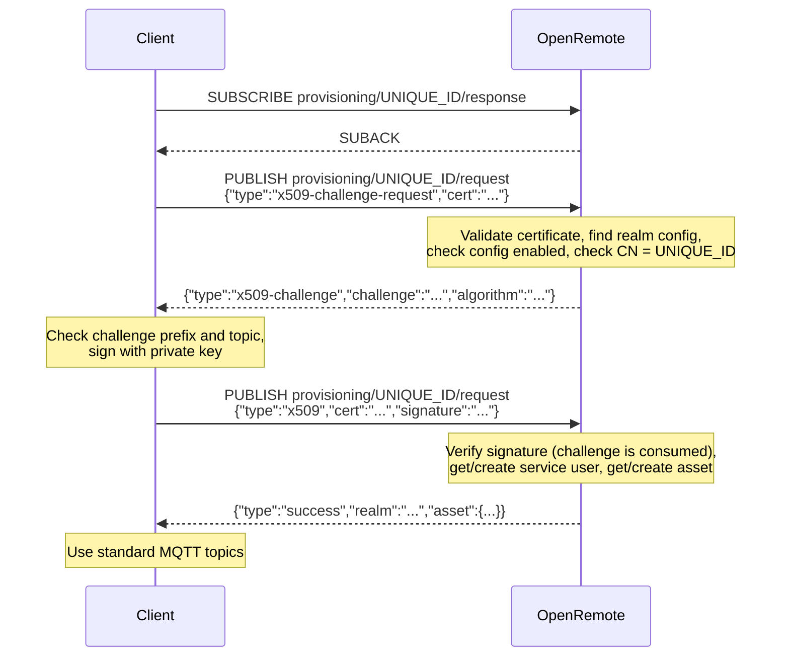
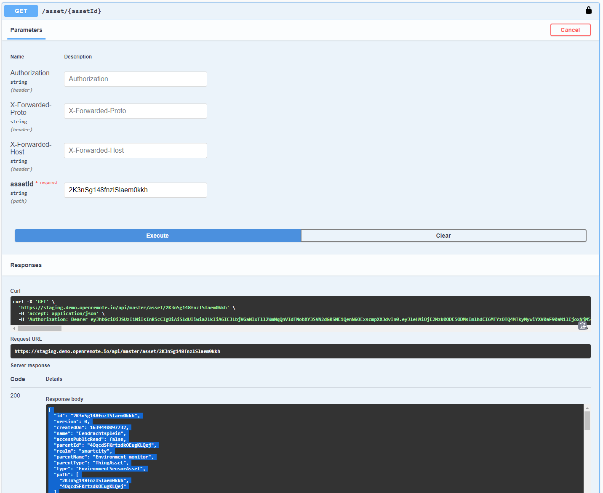

# Auto provisioning devices and users

OpenRemote offers functionality for automatic client and asset provisioning. If you build and distribute your own hardware devices, you can use this mechanism to have your devices automatically register and connect to OpenRemote.

When the auto provisioning is configured, an authorised device will first create a service user in OpenRemote, if it not already exists. Secondly it will create an asset in the specified OpenRemote Realm, with the attributes, using the 'Asset template'. Based on the 'Roles' the device can now communicate with this asset.

:::warning Breaking change in 1.34.0

From version 1.34.0 the X.509 provisioning flow is a two-step challenge exchange (see
[Connect flow](#connect-flow)). Devices that only send their certificate receive an
`UNAUTHORIZED` error and must be updated to sign the challenge. There is no compatibility mode,
including for devices that were provisioned before the upgrade.

:::

#### Terminology
* Client: Refers to the initiator in communication with OpenRemote; the same meaning as in authentication terminology.
* Asset: Any asset within the OpenRemote system.
* Provisioning: Creation within the OpenRemote system.

## Provisioning Type

There are two basic mechanisms for client provisioning.

### X.509 Client Certificate

Supports the industry standard X.509 certificate authentication mechanism where each client has a unique client certificate that is signed by a CA certificate that must also be registered within OpenRemote, the certificate must contain a unique ID within the CN attribute of the certificate. OpenRemote then verifies the certificate and CN attribute presented during provisioning.

The certificate itself is public, so presenting it is not enough: during provisioning the client must also prove it holds the certificate's private key by signing a one-time challenge issued by OpenRemote. The private key never leaves the device.

This is the most secure authentication mechanism but adds complexity to the manufacturing/flashing process.

### Symmetric Key (HMAC-SHA256)

**NOT YET IMPLEMENTED**

Uses a shared secret for authentication; HMAC protects the integrity and authenticity of the encrypted message; the HMAC is generated from a unique client ID and the shared secret; OpenRemote then verifies the HMAC based on the unique ID presented during provisioning.

This mechanism is less secure especially if the shared secret is stored in an accessible way on the client device; using a HSM (Hardware Security Module) protects against this; also pre-generating the client HMAC and loading this onto the client device before provisioning means the secret does not need to be shared, but once again complicates the manufacturing process.

## TL;DR
Jump to:

* [Implementation](#implementation)
* [Manager UI Configuration](#configuration)


## Implementation
### Connect flow

Clients auto provision a service user, and optionally an asset whose ID is generated from the client's `UNIQUE_ID`, through the [MQTT API](../050-manager-apis.md#mqtt-api-mqtt-broker) using a pair of topics per device, where `UNIQUE_ID` is the CN of the client certificate:

1. Subscribe to `provisioning/UNIQUE_ID/response` and wait for the SUBACK. Only the connection that holds this subscription may publish to `provisioning/UNIQUE_ID/request`, and a connection may only hold one provisioning response subscription.
2. Publish a [challenge request](#x509-challenge-request-message) containing the certificate.
3. Receive a [challenge](#x509-challenge-message), check it, and sign it with the certificate's private key.
4. Publish a [provisioning request](#x509-provisioning-request-message) containing the certificate and the signature.
5. Receive a [success](#success-response-message) or [error](#error-response-message) response. On success the connection is authenticated as the device's service user and the asset is returned, so the client can use the standard MQTT topics straight away.



Any validation step can instead respond with an [error](#error-response-message), and the client must then start again from step 2. A publish from a connection that does not hold the response subscription is rejected by the broker and is never answered.

**NOTE THAT THE 'WHITELIST/BLACKLIST FAILURE', IS NOT YET IMPLEMENTED. THIS FUNCTION ENHANCES SECURITY AS ONLY SPECIFIED DEVICES CAN CONNECT (WHITELIST) OR CAN BE EXCLUDED (BLACKLIST)**

#### X.509 Client Certificate Validation

1. Find X.509 realm config whose CA cert subject matches the client cert issuer
2. Check client certificate has been signed by the CA
3. Extract client certificate subject ‘CN’ value
4. Check it matches UNIQUE_ID
5. Verify the signature of the challenge issued to this connection against the certificate's public key

#### Symmetric Key Validation

**NOT YET IMPLEMENTED**

1. Regenerate HMAC using shared secret and UNIQUE_ID and check it matches
2. Find realm config match where HMAC generated using secret matches

### Message Schema

#### X.509 Challenge Request Message

```json
    {
      "type": "x509-challenge-request",
      "cert": "..."
    }
```

The cert field should be in PEM format and must contain the certificate chain up to and including the CA certificate registered within OpenRemote.

#### X.509 Challenge Message

```json
    {
      "type": "x509-challenge",
      "challenge": "OpenRemote MQTT X509 provisioning v1\nprovisioning/UNIQUE_ID/request\n<nonce>",
      "algorithm": "SHA256withRSA"
    }
```

Before signing, the client must check that `challenge` starts with `OpenRemote MQTT X509 provisioning v1\n` followed by its own request topic, and only sign a challenge received in response to its own request on the same connection. Otherwise a device signs whatever it is sent, which matters all the more if the same key is used for TLS client authentication.

Sign the exact UTF-8 bytes of the `challenge` string: do not Base64 decode it or sign its JSON representation. The `algorithm` is chosen from the certificate's public key:

| Key type | Algorithm | Signature format |
|---|---|---|
| RSA | `SHA256withRSA` | PKCS#1 v1.5 |
| EC (any curve) | `SHA256withECDSA` | ASN.1 DER |
| Ed25519 / Ed448 | `Ed25519` / `Ed448` | raw |

RSASSA-PSS keys are not supported and are rejected with `UNAUTHORIZED`.

A challenge is valid for 60 seconds, can only be used once, and is bound to the connection, topic and certificate it was issued for. Requesting a new challenge replaces the previous one. Reconnecting, an expired challenge or a failed signature all require a new challenge request.

#### X.509 Provisioning Request Message

```json
    {
      "type": "x509",
      "cert": "...",
      "signature": "..."
    }
```

`cert` must be the same certificate sent in the challenge request, and `signature` is the Base64 encoded signature of the challenge. A message without a valid signature is rejected with `UNAUTHORIZED`.

#### Symmetric Key Provisioning Request Message

**NOT YET IMPLEMENTED**

The provisioning message format for HMAC is as follows:

```json
    {
      "type": "hmac-sha256",
      "code": "..."
    }
```

The code field should be the base64 encoded HMAC specific to this client.

#### Success Response Message

```
    {
      "type": "success",
      "realm": "REALM_NAME",
      "asset": {...}
    }
```

#### Error Response Message

```json
    {
      "type": "error",
      "error": "ERROR_TYPE"
    }
```

##### Error Type

* MESSAGE_INVALID - Failed to parse the request message
* CERTIFICATE_INVALID - The X.509 certificate is not valid
* UNAUTHORIZED - No matching config found, the signature is missing or invalid, the challenge has expired or was already used, or the certificate's key type is not supported
* FORBIDDEN - Unique ID fails whitelist/blacklist
* UNIQUE_ID_MISMATCH - Unique ID used in subscription does not match credentials
* CONFIG_DISABLED - Matched realm config is marked as disabled
* USER_DISABLED - Service user previously provisioned has been disabled
* SERVER_ERROR - Unknown exception occurred during processing
* ASSET_ERROR - Asset previously provisioned is not in the same realm as the matched realm config

#### Certificate Generation

Client certificate generation is done using standard tooling e.g. openssl:

1. A unique client private key and X.509 certificate should be generated with the client’s unique ID stored in the CN attribute of the certificate.
1. The certificate should then be signed by an intermediate CA (can be self-signed or signed by a CA)
1. The intermediate CA certificate is then uploaded into OpenRemote within a Realm config instance

When the client sends its certificate to OpenRemote it must be in the PEM format. Client certificate generation can take place within the manufacturing environment without any external dependencies.

The device's private key is needed on the device at provisioning time to sign the challenge, but it is never sent to OpenRemote. Where the hardware allows, generate and keep the key in a secure element or HSM (e.g. an ATECC608 with an EC P-256 key, which uses `SHA256withECDSA`) so that it cannot be extracted from the device.

:::note

The security of the CA private key(s) is essential, if compromised then the certificate can be marked as revoked within OpenRemote and this will require all client certificates signed by this compromised CA certificate to be replaced at considerable effort.

:::

##### Some useful commands:

Generate self-signed CA cert (inc. key):
```shell
openssl req -x509 -sha256 -nodes -newkey rsa:4096 -keyout ca.key -days 730 -out ca.pem
```
Generate CSR for device (inc. key):
```shell
openssl req -nodes --newkey rsa:4096 -keyout deviceN.key -subj "/C=NL/ST=North Brabant/O=OpenRemote/CN=deviceN" -out deviceN.csr
```
Generate signed cert for device:
```shell
openssl x509 -req -in deviceN.csr -CA ca.pem -CAkey ca.key -CAcreateserial -out deviceN.pem -days 500 -sha256
```

Keep `deviceN.key` on the device; it is required to sign the provisioning challenge.

### Asset provisioning
When a client (device) successfully authenticates it is possible to auto provision an asset that can represent the client within OpenRemote; this is done by providing an asset template (an asset in `JSON` representation) that will be hydrated, stored and returned to the client within the success message payload. The ID of the created asset is derived from the `UNIQUE_ID` so on future authentications the previously created asset can be found and just returned rather than re-created. The following placeholder can be used in the asset template to allow for automatic substitution of the authenticated client's `UNIQUE_ID`:

```
%UNIQUE_ID%
```

The type of the asset generated must be an asset type that exists in the system; otherwise the creation will fail and client authentication will also fail. The asset template must contain all the attributes and configuration (meta) items that you want to be present on the created asset.


## Configuration
Configuration of auto provisioning is done via the `Manager UI` -> Auto Provisioning (top right menu); the menu item is only present for superusers.

Devices must provision over TLS (MQTT port 8883) and verify the server's certificate. The challenge proves the device holds its private key, but it does not replace transport security.


### Provisioning Configuration
Provisioning Configurations are used to allow configuration of the above via the `Manager UI`; a realm can contain any number of `Provisioning Configuration` items.

:::note

If a client matches more than one provisioning configuration there is no guarantee which one will be used.

:::

A provisioning configuration contains the following data:

* Name - Label to be assigned to this provisioning configuration for identification [REQUIRED]
* Type - The authentication mechanism to use (currently only `X.509` supported) [REQUIRED]
* Realm - The realm that the provisioning config applies to [REQUIRED]
* Roles - The roles to apply to each auto provisioned service user (default: `none`) [OPTIONAL]
* Create restricted user - Should the auto provisioned service user be made restricted (default: `false`) [OPTIONAL]
* Disabled - Is this provisioning config disabled (no clients will be able to authenticate through it whilst disabled) (default: `false`) [OPTIONAL]
* Asset template - If specified an instance of this asset will be auto provisioned upon successful authentication; only provisioned if an asset matching the client's `UNIQUE_ID` does not already exist (default: `none`) [OPTIONAL]

<details>
<summary>Example Asset template (see below for more information about obtaining an asset template)</summary>

```json
{}
```

</details>

The following data is specific to the `X.509` mechanism:

* Ignore expiry date - Optionally ignore client certificates that have expired; they must still have been signed by the CA certificate (default: `false`) [OPTIONAL]
* CA certificate (PEM) - The signing authority CA certificate that must match the CA certificate used to sign each client's certificate and must be in PEM format **DO NOT PUT PRIVATE KEY IN HERE** [REQUIRED]

<details>
<summary>Example PEM CA certificate</summary>

```
-----BEGIN CERTIFICATE-----
MIIF/TCCA+WgAwIBAgIUZ/o8/s1N8dM2kn3jqrzMfoF+/SMwDQYJKoZIhvcNAQEL
BQAwgYwxCzAJBgNVBAYTAk5MMRYwFAYDVQQIDA1Ob3J0aCBCcmFiYW50MRIwEAYD
VQQHDAlFaW5kaG92ZW4xEzARBgNVBAoMCk9wZW5SZW1vdGUxFjAUBgNVBAMMDW9w
ZW5yZW1vdGUuaW8xJDAiBgkqhkiG9w0BCQEWFXN1cHBvcnRAb3BlbnJlbW90ZS5p
bzAgFw0yMTEwMjgxMTA5MjJaGA8yMDcxMDIwODExMDkyMlowgYwxCzAJBgNVBAYT
Ak5MMRYwFAYDVQQIDA1Ob3J0aCBCcmFiYW50MRIwEAYDVQQHDAlFaW5kaG92ZW4x
EzARBgNVBAoMCk9wZW5SZW1vdGUxFjAUBgNVBAMMDW9wZW5yZW1vdGUuaW8xJDAi
BgkqhkiG9w0BCQEWFXN1cHBvcnRAb3BlbnJlbW90ZS5pbzCCAiIwDQYJKoZIhvcN
AQEBBQADggIPADCCAgoCggIBALYNz5ZWMpFu+2K1kNep34Keh2clknA7Rm3Wke7p
HoTpjddqHNvQSVjSOB7CZA1E5+a8O7mU6kvnE3wed/h+DO3cQWihbYTw9lNr9+2M
LS8+jny+lDeuXOMXxcb3og4Cn88mfPihdsUkmI/i7Hk3oSjonyLPycMW/M3d1S6L
6YkgrdkA3jbMtaR9epcCv/g1P9WBKzF05qIs1lVEzGXOyF2Km2rPAdUcUjFplBbE
DyUgzbAYsdUTz0PCvAFi1y82/xreWeZQ8OlW1TnqMOR0elVDf/d8An+a3LV/uSaB
ihmdS4yvxcqZNGU+ShbBO6P+8JjLQNDmPQgjEURCYT4NyHRBChJr31CCvV2QJ2Ik
Hn5by9/KvvnZ/5y3KjYht9V3ooD0ptxIVKhhwuNFeDSC9Pnqr2QL+mawlWq+Wq/q
/PMN034gTqLkYAsm4ltoQj/L0ebRdQ0t9L9FML4+fDtEOWAUz3/vRcN1J2y5dNjZ
Y4H+bTAemGXpD3kz0VyhKWdPGQZgAMJ6gEHHzY4Ooi3UsLXt53knmLjkG3jo6g/Y
WJOiWcn7TlRRj9Pjmj+aTx1/9o8+3MnEm0THAUX1zN5IUfU1OnpcHWee2QbUlaTu
dYYYZQ+dCJImSWgp48FMFwPXLibF/xsAfYAIhw9isfQSe0JmUBv41MsOyzHJBYsA
H29NAgMBAAGjUzBRMB0GA1UdDgQWBBQnxsJQgUOdmW/iSvTJ67WtpHe8ojAfBgNV
HSMEGDAWgBQnxsJQgUOdmW/iSvTJ67WtpHe8ojAPBgNVHRMBAf8EBTADAQH/MA0G
CSqGSIb3DQEBCwUAA4ICAQBIbKYJDzEWn6yP44t3BYLb/1XIW/f+LUCNDIdlXKco
sxcMddWHNLFTC05fd/HKaUWBGEMBpuV2EjZHCxX8b3g5yhEMy2gU3BaMel777vcg
EG7c82+kOzuunuH7vUTi4NhTFko/iIgqlIbQYF/8oWnFH7tn5PMhaiGEMMEOCf1Y
fKedTGM+Or4e/ptddWroucqw9wzIZ9Wi/YYsLxwpdew2Eay7OZhY8qnH5rvkiUjG
SgkSmxyN3F+EZQj00G15yVmFpJ1bhLT4s9a33gqcMUon0eHVlGpLcF/0vxVvZ5zr
UUPb1MKUhxSqpFC7h+2odlDwtfepCCTAvpnqiI794ewvkblcafJ5lbypNUjTSXBA
+Fi1BcJteEBCVGOOLs34bquAtNdPEmc37wZA+5QNdz9WnYLCgvnrPh8VEXTdqqqb
Mf4/Rr0GbUOmRZXk0LordT3IwOq67c2HrbTFD5H6SGgEiyslzGeDjZyMWJ6uy+ae
MydnFVor6diyzew3MwhCZJKxMu/UJYaECuUtazLWhQi3q0YbQlYMcIGHfp7jDpXa
1ibFAeRSri7PXTVqMNuJ1dftG7s08V55N1AB/3w9f8kkOOO2jZpwRauhIUJA++Xh
Iq6M+PLEvBky6g/v6zOf7/68LtseuaSmMw7GxRVXX2BcrEjSLVz24INa24ZxM87P
qQ==
-----END CERTIFICATE-----
```

</details>

This must be formatted for use in the JSON payload by replacing new line characters with embedded new line characters, an example command to do this:
```shell
awk 'NF {sub(/\r/, ""); printf "%s\n",$0;}'
```

## Obtaining an asset template
1. Log into the `Manager UI` and navigate to the asset viewer
1. Create then select an asset of the same type that you want to use in the template then select the asset ID from the address bar (e.g. `https://staging.demo.openremote.io/manager/?realm=smartcity#/assets/false/2K3nSg148fnzlSlaem0kkh` -> `2K3nSg148fnzlSlaem0kkh`)
1. Navigate to Swagger UI (https://your_installation/swagger e.g. https://staging.demo.openremote.io/swagger)
1. Click authorize then again on the popup dialog then login with a user from the master realm
1. Once authenticated go to `Assets -> Get /asset/{assetId}` and paste the asset ID into the asset ID input then execute the query, you will then get the asset returned in `json` format: 
1. You can copy the returned `json` and paste that into the `Asset template` input field:
   1. Remove or set the `parentId` to determine where in the asset tree the asset will be created
   1. remember to insert the `%UNIQUE_ID%` placeholder wherever you would like that to be used (in an attribute value, in the asset name, etc.)


## See Also

* [Git GitHub, Self Signed Certificate with Custom Root CA](https://gist.github.com/fntlnz/cf14feb5a46b2eda428e000157447309)
* [Whitepaper Device Manufacturing and Provisioning with X.509](https://d1.awsstatic.com/whitepapers/device-manufacturing-provisioning.pdf)
