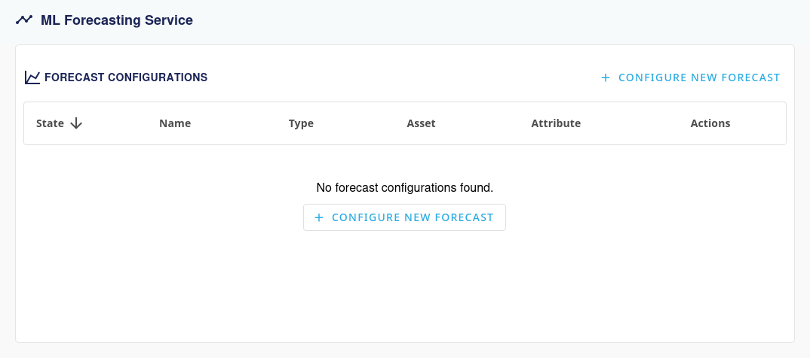
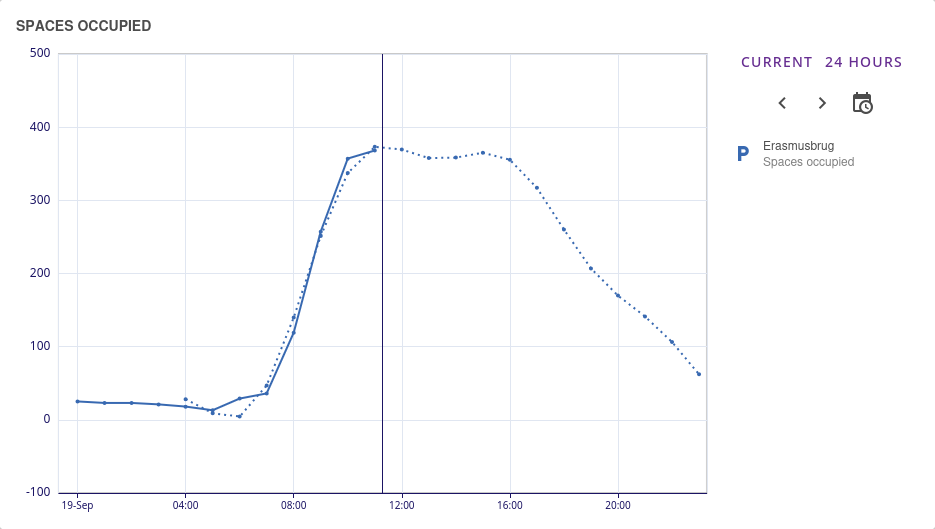

# Forecasting Service

The Forecasting Service is an **optional** service that applies machine learning and statistical models to time series forecasting.
It lets you create forecast configurations for asset attributes with historical data.
It supports XGBoost, LightGBM, Prophet, and Weighted Exponential Average.

:::note

This service is not installed by default.
It can be installed by your administrator by following the instructions on the [External Services](../../developer-guide/090-external-services.md) page.

:::

## Features

- Create forecast configurations for asset attributes with historical data
- Automatically train models and generate forecasts at a specified interval
- Manage forecast configurations using collapsible configuration groups
- Choose between four forecasting models and adjust their parameters
- Add historical or future regressors where supported by the model
- View generated forecasts as predicted datapoints in the Insights UI

## Accessing the Service

To access the service, navigate to the `Services` page in the Manager UI.

If the service is properly installed, you will see `Forecasting Service` in the list of services.

## Usage

When the service is selected, you should see a list of forecast configurations.
If none are present, you can create one by clicking the `Configure New Forecast` button.

You can then configure the forecast by filling in the form.

### Configuration Form

The form is divided into collapsible groups.
The available parameters and regressor groups depend on the selected model.

The form contains defaults for forecast generation, training data, and model parameters.
Start with these defaults and adjust them based on comparisons with actual readings.

| Section | Field | Description |
|---------|-------|-------------|
| **Properties** | `Model name` | The name of the forecast configuration |
| | `Enabled` | Whether the configuration is scheduled for training and forecasting |
| **Model configuration** | `Model type` | The model to use for forecasting |
| **Forecast generation** | `Generate new forecast every` | How often to train the model and generate new predictions |
| | `Unit` | Time unit for the generation interval |
| | `Forecasted datapoints` | Number of future datapoints to generate |
| **Forecast target** | `Asset` | Asset containing the attribute to forecast |
| | `Attribute` | Attribute whose historical values are used as the forecast target |
| **Data and sampling** | `Time between datapoints` | Time interval between consecutive forecast datapoints |
| | `Unit` | Time unit for the datapoint interval |
| | `Training data period` | Historical period used for model training |
| | `Unit` | Time unit for the training data period |

The forecast length is determined by the number of forecasted datapoints and the time between them.
For example, 24 datapoints with an interval of one hour produce a 24-hour forecast.

The generation interval controls how often this forecast is updated.
It is separate from the interval between individual forecast datapoints.

Use one enabled configuration per target asset attribute.
The service rejects attempts to create or update an enabled configuration when another enabled configuration already uses that target.

#### Choosing a Model

| Model | Description | Supported regressors |
|-------|-------------|----------------------|
| `XGBoost` | A boosted tree model that uses previous target values and optional additional inputs to learn forecasting patterns | Past and future regressors |
| `LightGBM` | A boosted tree model with the same lag and regressor controls as XGBoost | Past and future regressors |
| `Prophet` | A model that represents trends and seasonal patterns, with optional additional inputs | Future regressors |
| `Weighted Exponential Average` | A statistical method that combines values from earlier periods, giving more weight to recent periods | None |

The most suitable model depends on the available data and the behavior of the target attribute.
Compare forecasts against actual readings before selecting a model for your use case.

#### XGBoost and LightGBM Parameters

XGBoost and LightGBM share the `Tree model parameters` group.

| Field | Description |
|-------|-------------|
| `Target history lags (steps)` | Previous target observations used as inputs. Enter a positive count, such as `24`, or a list of specific negative steps, such as `[-24, -168]` |
| `Output chunk length` | Number of consecutive forecast steps predicted at once by the model |
| `Number of estimators` | Number of boosted trees |
| `Max depth` | Maximum depth of each tree |
| `Learning rate` | Contribution of each boosting step. Smaller values generally require more estimators |
| `Subsample` | Fraction of training observations used when fitting the trees, subject to the selected model's sampling behavior |
| `Random state` | Seed used for reproducible model behavior |

Lags are measured in datapoint intervals.
With an hourly interval, a lag of `-24` refers to the observation 24 hours earlier.

The training data must contain enough aligned observations for the selected lags and output chunk length.
Increasing the number of lags can require a longer training data period.

The output chunk length does not replace the `Forecasted datapoints` setting.
When the requested forecast is longer than the output chunk length, the model generates the remaining steps recursively.

#### Prophet Parameters

| Field | Description |
|-------|-------------|
| `Changepoint range` | Proportion of the training history in which trend changes can be detected. The default is `0.8` |
| `Changepoint prior scale` | Controls trend flexibility. Lower values produce smoother trends; higher values allow larger trend changes. The default is `0.05` |
| `Seasonality mode` | `Additive` applies seasonal adjustments in the target's units. `Multiplicative` applies seasonal adjustments relative to the trend |
| `Daily seasonality` | Include repeating daily patterns |
| `Weekly seasonality` | Include repeating weekly patterns |
| `Yearly seasonality` | Include repeating yearly patterns |

Enable seasonal patterns that are relevant to the target and supported by the available history.
A short training period cannot establish a reliable yearly pattern.

#### Weighted Exponential Average Parameters

Weighted Exponential Average uses only the historical values of the target attribute.

| Field | Description |
|-------|-------------|
| `Past period` | Time between the historical periods used for comparison |
| `Past count` | Number of historical periods to combine |

For example, a past period of seven days and a past count of four use observations from four previous weekly periods.
More recent periods receive more weight.

The training data period must include the historical observations required by all selected periods.
The forecast length must not exceed the past period.

Past periods use fixed elapsed durations.
A period of seven days represents 168 hours, including across daylight saving time changes.

#### Regressors

Regressors provide additional inputs that may help explain changes in the target attribute.
For example, weather forecasts or known operating schedules may help forecast energy consumption.

Click `Add regressor` in the relevant group and select the asset and attribute to use.

| Field | Description |
|-------|-------------|
| `Asset` | Asset containing the regressor attribute |
| `Attribute` | Attribute to use as an additional model input |
| `Training data period` | Historical period to retrieve for the regressor |
| `Unit` | Time unit for the regressor training data period |

Regressor data must cover the timestamps required by the target training data and the selected lag settings.

**Future regressors**

Prophet uses the `Regressors` group for future regressors.
XGBoost and LightGBM provide a separate `Future regressors` group.

These inputs require historical data for training and future values available when the forecast is generated.
For tree models, future regressor lags are specified as a list of zero or positive steps.
A lag of `[0]` uses the regressor value corresponding to each prediction step.

:::important

Future regressors must have predicted datapoints covering the complete forecast period and any additional timestamps required by the configured lags.
If the required values are missing, the service cannot generate the forecast.

Future values can be supplied by another forecast configuration, an external data source, or another mechanism such as a rule.
Ensure those values are available before the dependent forecast runs.

:::

**Past regressors**

XGBoost and LightGBM also provide a `Past regressors` group.
These inputs use observed historical values rather than separately predicted future values.

Past regressor lags can be entered as a positive count or a list of negative steps.
Choose lags that remain available throughout the complete forecast.

When a forecast is generated recursively, lags that are too recent can require observations beyond the available history.
Use suitable historical lags or adjust the output chunk length and forecast length.

Weighted Exponential Average does not support regressors.

#### Training Data

The target attribute must have numeric historical datapoints available in OpenRemote.
The amount of history needed depends on the selected model, sampling interval, lags, and seasonal patterns.

XGBoost, LightGBM, and Prophet align training data to the configured datapoint interval.
Missing or invalid data can prevent training when the required series cannot be constructed.

Weighted Exponential Average uses historical observations without resampling or interpolation.
It requires observations in each selected historical period.

Increasing the training data period does not necessarily improve forecast accuracy.
Use enough history to represent relevant patterns, while considering changes in how the asset operates.

#### Saving Configuration

Once the fields are configured, click `Save` to store the forecast configuration.
You can then navigate away from the configuration page.

For an enabled configuration without a compatible trained model, the service attempts initial training after detecting the configuration.
New predictions are published only after training succeeds.

Training and forecasting use the configured generation interval, with training performed before forecasting.
There is no separate model training interval in the configuration form.

Changes to the model, target, training data period, forecast length, sampling interval, or model parameters require a compatible newly trained model before new predictions can be published.
A failed training attempt prevents publication of new predictions for that configuration.

Disabling a configuration stops its scheduled training and forecasting.
It does not remove predictions already stored in OpenRemote.

## Viewing the Forecast

Once the forecast is generated, you can view it in the Insights UI.

The forecast is displayed as a dotted line in the chart.
Compare it with actual readings for the same attribute and time period.

Consider the configured datapoint interval when interpreting the chart.
For example, an hourly forecast and minute-level readings represent different time resolutions, so a short minute-level peak can be much higher than the corresponding hourly forecast.

Updating a forecast writes new values at the generated timestamps.
Previously stored predictions outside the new forecast range are not automatically removed.
Changing the target also leaves previously stored predictions on the original target.

## Next Steps

Now that you understand how to set up and use the Forecasting Service, you can:

1. **Monitor the results** in the Insights UI to verify forecast quality
2. **Compare models and parameters** using the same target data, forecast interval, and evaluation period
3. **Add regressors** when relevant inputs are available at forecast time
4. **Add additional forecasts** for other asset attributes